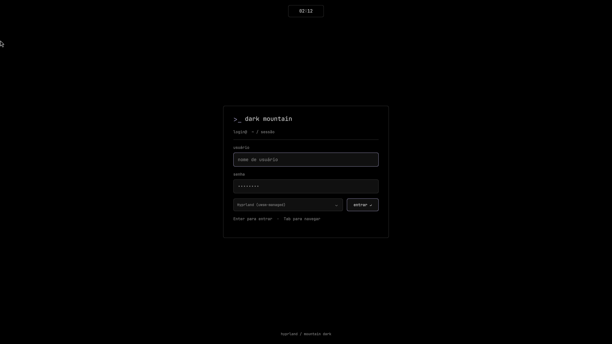

# Dark Mountain

Rice para Hyprland **Lua** + Quickshell, com fundo preto, montanhas vetoriais e cantos de **6 px**. Há somente três temas: **Mountain Dark**, **Monocromático** e **Mountain Red**. A paleta base vem de [Mountain / Fuji](https://github.com/mountain-theme/Mountain); licença em `licenses/Mountain-MIT.txt`. As variantes e os wallpapers são adaptações locais.



## Antes de instalar

Este projeto foi desenvolvido em **Arch Linux**, com **Hyprland 0.57.1 (configuração Lua)** e **Quickshell 0.3.2**. Não é uma configuração para `hyprland.conf` e não converte configurações antigas. Os bootstraps dependem do pacman e dos pacotes do Arch; outras distribuições exigem adaptação.

1. Clone o repositório e entre na pasta com `cd dark-mountain`. Execute os comandos abaixo a partir dela.
2. Revise `hypr/theme.lua`: teclado ABNT2, fuso Brasília e atalhos são os padrões do perfil. O rice preserva monitores, resolução, taxa de atualização e escala definidos na sua configuração base. A curva de animação do rice é definida pelo próprio módulo.
3. Instale as dependências e execute `scripts/install.py`. O instalador altera a configuração existente e cria backups; mantenha uma cópia própria antes de instalar.
4. Instale a suíte de aplicativos se quiser todos os atalhos e utilitários. O login SDDM é uma etapa opcional e separada.

Mantenha a pasta do projeto no local escolhido: as configurações instaladas são links simbólicos. Os scripts de instalação devem ser executados como usuário normal, exceto `install-login.py`. Garanta que `~/.local/bin` esteja no `PATH`.

A imagem acima mostra apenas o login. A aparência da sessão depende das versões e das configurações da máquina.

## Uso em PC físico

Instale e valide primeiro o Hyprland com os drivers adequados à sua GPU e uma sessão Wayland funcional. O instalador do rice não instala drivers de vídeo, não configura boot nem substitui a configuração dos monitores. Não inclui ajustes exclusivos de VirtualBox. Áudio e energia dependem dos serviços PipeWire/WirePlumber e UPower da máquina.

Antes de aplicar, confirme suas telas com `hyprctl monitors` e ajuste resolução/escala na configuração base, se necessário. Não é preciso usar a resolução da VM. O tema foi validado originalmente em VM; GPU, suspensão e gravação no computador físico ainda precisam de teste no hardware de destino.

## Uso e atalhos

| Atalho | Ação |
| --- | --- |
| **Super + Shift + T** | Alternar os três temas; atualizar também bordas, Kitty e wallpaper |
| **Super + Shift + W** | Alternar somente o wallpaper |
| **Super + Shift + B** | Ocultar a Island e maximizar a janela atual; repetir restaura ambos |
| **Super + Shift + P** | Abrir o menu de suspender, desligar e reiniciar |

A tecla Super normalmente é a tecla Windows. Os atalhos existentes são preservados.

| Atalho | Aplicativo ou utilitário |
| --- | --- |
| **Super + Espaço** | Buscar aplicativos na própria Dynamic Island |
| **Super + N** | LazyVim / Neovim |
| **Super + D** | Lazydocker |
| **Super + T** | tmux, sessão `main` |
| **Super + F** | Yazi |
| **Super + Shift + V** | Clipboard na Dynamic Island |
| **Print** | Congelar a tela, selecionar região e salvar/editar |
| **Shift + Print** | Congelar a tela inteira e salvar/editar |
| **Super + Shift + R** | Opções de gravação; se já estiver gravando, parar |
| **Super + Shift + Q** | Fechar a janela atual |
| **Super + Ctrl + Shift + Q** | Confirmar encerramento da sessão na Island |

Os novos aplicativos também aparecem na busca por aplicativos. As capturas vão para `~/Pictures/Screenshots` e as gravações para `~/Videos/Recordings`. O gravador oferece tela inteira ou região, com ou sem áudio. A captura mostra uma imagem fixa da tela: arraste a região e use **Salvar/Enter**, a **engrenagem/E** para abrir o Swappy, ou **Esc** para cancelar. Salvar e editar também copiam o PNG. **Configurações → Capturas** reabre o último print no editor. O Swappy usa a paleta atual do rice. A notificação da gravação aparece somente ao finalizar.

A busca transforma a Island em campo de pesquisa e lista de aplicativos; aceita acentos, setas, Enter, Escape e clique externo. Entradas de terminal abrem no Kitty. Os utilitários usam ícones próprios e há um ícone de fallback para aplicações sem ícone instalado. **Configurações → Atalhos** lista as combinações do rice.


- Em repouso, a Island central mostra `HH:mm`, com 32 px de margem de cada lado. Durante uma gravação, também mostra o ícone vermelho e amplia sua largura para acomodá-lo. O fuso é **Brasília** (`America/Sao_Paulo`).
- Passar o mouse revela workspaces à esquerda, relógio central e ícones à direita; abaixo aparece o player com capa, título, artista, controles e tempo. Ao sair, recolhe após 400 ms.
- As bolinhas representam os workspaces existentes; ficam ocultas com apenas um. O ativo usa o destaque do tema.
- Som, rede e notificações abrem somente seus próprios controles. O ícone de clipboard abre uma lista pesquisável na própria Island; Enter ou clique copia o item e fecha o painel. A engrenagem abre todas as abas, incluindo aplicativos, mídia, temas/wallpaper, energia, capturas e atalhos. Microfone e aplicativos não têm ícones na barra.
- **Clicar fora fecha os painéis**, o calendário e o menu de energia. Escape também fecha. O clique externo usa `HyprlandFocusGrab`, sem uma superfície invisível cobrindo a tela.
- Clicar no relógio exibe `HH:mm:ss` e o calendário do mês atual. As setas navegam entre meses e anos; reabrir retorna ao mês atual de Brasília.
- Notificações transformam a mesma Island em cartão com título, corpo e ações, com largura e altura ajustadas ao conteúdo. Há fila, substituição por ID, central de mensagens e Não perturbe. O sino só aparece quando há mensagens; o histórico em memória mantém até 100 e é perdido ao encerrar o Quickshell.
- O menu de energia também está na aba **Energia**, dentro das configurações. Selecionar uma ação mostra **Confirmar/Cancelar**; clicar fora cancela. Suspender/desligar/reiniciar usam `systemctl`; encerrar sessão chama a saída do Hyprland, após confirmação. Os erros aparecem no painel.

O tema e o wallpaper são independentes e persistem ao reiniciar. Selecionar um tema aplica seu wallpaper correspondente; depois é possível escolher outro wallpaper sem mudar a paleta. A aba **Temas e wallpaper** oferece essas opções.

## Janela e espaçamentos

O Hyprland usa `gaps_in = 2`, `gaps_out = 2`, borda de **1 px** e raio de 6 px. Janelas focadas e desfocadas usam a mesma cor da borda normal da Island, sem destaque de foco. O Kitty usa fundo com opacidade **0,90**; o blur do Hyprland está ativo (tamanho 5, duas passagens), preservando a nitidez do texto. A Island fica a 2 px do topo e reserva 42 px. Com ela visível, há 2 px entre sua área reservada e a borda externa das janelas.

**Super+Shift+B** desmapeia a Island, libera a reserva superior e maximiza a janela no espaço útil, mantendo **2 px entre sua borda externa e cada lado da tela**. A segunda ativação restaura o estado de fullscreen anterior e a Island. Isso também funciona quando um painel da Island está com foco. Se não houver janela no workspace, o atalho apenas oculta a Island. Abrir o menu de energia enquanto a Island está oculta restaura o modo normal antes de mostrar o menu.

O estado da janela é identificado por endereço, PID e identificador estável. Se a janela deixar de existir, a próxima inicialização limpa o modo de ocultação. Parar a Island pelo launcher também restaura o modo normal.

## Instalação e comandos


### Instalador automático

Com o projeto já clonado, execute como usuário normal:

```bash
bash install.sh
```

O script instala dependências com `sudo pacman -S --needed`, baixa a suíte de aplicativos no runtime do usuário, aplica os links com backup e recarrega o rice se houver uma sessão Hyprland ativa. Mantenha seu Arch atualizado antes de executá-lo. Ele exige uma configuração **Hyprland Lua existente**; revise teclado e fuso em `hypr/theme.lua` antes de aplicar.

Para baixar o projeto com o instalador avulso, substitua `SEU_USUARIO` pela conta que hospeda o repositório:

```bash
curl -fL https://raw.githubusercontent.com/SEU_USUARIO/dark-mountain/main/install.sh -o /tmp/dark-mountain-install.sh
bash /tmp/dark-mountain-install.sh --repo https://github.com/SEU_USUARIO/dark-mountain.git
```

O destino padrão é `~/dark-mountain`. O instalador recusa sobrescrever um destino existente: para reaplicar, execute `bash install.sh` dentro da cópia existente. Ele não faz `git pull` nem descarta alterações locais.

```bash
bash install.sh --help
bash install.sh --minimal --no-start    # Apenas o desktop, sem ativar agora
bash install.sh --skip-deps             # Dependências de sistema já instaladas
bash install.sh --with-docker           # Inclui serviço Docker rootless
bash install.sh --sddm                  # Inclui login; solicita sudo, sem reiniciá-lo
```

Por padrão, instala os aplicativos sem configurar ou iniciar Docker. `--with-docker` exige `newuidmap`, `newgidmap` e intervalos de pelo menos 65536 IDs em `/etc/subuid` e `/etc/subgid`. Os plugins LazyVim são baixados ao abrir o Neovim pela primeira vez. `--minimal` deixa os atalhos dos aplicativos disponíveis, mas esses aplicativos e o histórico de clipboard precisam ser instalados separadamente. `--no-start` adia a recarga explícita; o Hyprland pode perceber alterações nos arquivos monitorados.

### Navegadores

A instalação padrão inclui **Brave, Chromium e Firefox**, disponíveis na busca **Super + Espaço** pelas entradas de aplicativo dos pacotes. Seus perfis e navegador padrão são preservados.

Firefox e Chromium são instalados dos repositórios oficiais do Arch. Brave usa o pacote `brave-bin` do AUR, conforme a [orientação do Brave para Arch](https://brave.com/linux/). Se `paru` ou `yay` estiver instalado, o script o utiliza; caso contrário, baixa a receita do AUR e executa `makepkg` como usuário normal. A instalação pode solicitar senha e confirmação dos pacotes. Atualize Brave pelo AUR; Firefox e Chromium pelo pacman. Um Brave já disponível no PATH é preservado.

```bash
bash install.sh --no-browsers            # Instala o rice sem os navegadores
bash scripts/install-browsers.sh         # Instala apenas os três navegadores
```

`--minimal` também pula os navegadores. Com `--skip-deps`, os três devem estar instalados ou você deve informar `--no-browsers`. Os navegadores são instalados como pacotes nativos, fora do runtime privado de aplicativos.

### Instalação manual

Requer uma configuração existente em `~/.config/hypr/hyprland.lua` (ou `$XDG_CONFIG_HOME/hypr/hyprland.lua`), Python 3, ripgrep, iproute2 e Quickshell com Hyprland, MPRIS, PipeWire e UPower. O projeto registra sua própria curva `darkMountainEaseOutQuint`. A sessão foi validada com Hyprland 0.57.1 e Quickshell 0.3.2.

```bash
# Pacotes de sistema, se necessário:
sudo pacman -S quickshell qt6-svg ripgrep iproute2 ttf-jetbrains-mono-nerd
python3 scripts/install.py
hyprctl reload
~/.local/bin/dark-mountain start
```

Alternativa para Arch Linux: runtime local sem root (requer a base de pacotes do pacman atualizada):

```bash
python3 scripts/bootstrap-runtime.py
python3 scripts/install.py
hyprctl reload
~/.local/bin/dark-mountain start
```

O bootstrap baixa os pacotes dos repositórios do pacman, verifica SHA-256 contra a base local e extrai somente `usr/` em `~/.local/lib/dark-mountain/runtime`. Requer rede e bsdtar. O launcher prefere Quickshell de sistema quando disponível. O runtime local não recebe atualização automática; execute novamente o bootstrap após mudanças relevantes no Qt/Arch.

```bash
~/.local/bin/dark-mountain status
~/.local/bin/dark-mountain restart
~/.local/bin/dark-mountain stop
~/.local/bin/dark-mountain preview       # Pare a instância ativa antes
~/.local/bin/dark-mountain theme         # Próximo tema
~/.local/bin/dark-mountain theme red     # mountain, mono ou red
~/.local/bin/dark-mountain wallpaper     # Próximo wallpaper
~/.local/bin/dark-mountain wallpaper mono
~/.local/bin/dark-mountain focus
~/.local/bin/dark-mountain power         # Abre o menu; não desliga diretamente
```

A configuração é instalada por links simbólicos; mantenha o projeto no local escolhido. Os atalhos e os processos da Island usam o mesmo controlador. A seleção fica em `$XDG_STATE_HOME/dark-mountain/theme.json` (padrão `~/.local/state`), com a paleta Lua em `colors.lua` e o estado de ocultação em `focus.json`. Alterar um tema atualiza a paleta do Kitty preservando suas opções de fonte.

O Dunst é parado ao iniciar a Island e volta ao pará-la caso estivesse ativo antes da integração. O processo de Quickshell é único mesmo ao iniciar repetidamente.

## Aplicativos de terminal

Para instalar a suíte no usuário em Arch Linux:

```bash
python3 scripts/bootstrap-apps.py
python3 scripts/setup-apps.py
nvim --headless '+Lazy! sync' +qa
hyprctl reload
~/.local/bin/dark-mountain restart
```

`bootstrap-apps.py` usa pacotes oficiais do Arch, verifica SHA-256 contra a base local do pacman e os extrai em `~/.local/lib/dark-mountain/apps-runtime`. Os wrappers ficam em `~/.local/bin`. Os caminhos absolutos de duas bibliotecas de Neovim/mpv foram realocados somente nas cópias privadas. Para atualizar, repita o bootstrap; o runtime não recebe atualizações automáticas do sistema. O instalador também fornece compilador, tree-sitter CLI, fzf, fd, chafa e utilitários de preview exigidos pela suíte.

- **LazyVim:** baseado no starter oficial, com clipboard Wayland e cores do rice. A troca de tema é acompanhada ao vivo, sem reiniciar o editor. `Normal` usa fundo transparente; menus e janelas flutuantes usam fundo escuro legível.
- **Yazi:** arquivos em três colunas, preview de mídia/documentos, ícones e destaques seguindo a paleta ANSI. Enter em PDF/imagem abre o visualizador de páginas/imagens; Enter em vídeo abre **mpv** no próprio Kitty. Os openers usam `%s`, conforme a sintaxe do Yazi 26.9.1; nomes com espaços são escapados pelo próprio Yazi. Arquivos de texto abrem no LazyVim.
- **PDF, imagem e vídeo:** padrões de abertura via desktop. PDF usa Poppler para renderizar as páginas, e imagens/páginas são transmitidas diretamente ao Kitty, sem memória compartilhada. Setas e PgUp/PgDn navegam no PDF; `q`/Esc fecha. As cores originais do documento são preservadas. O vídeo usa mpv/FFmpeg com `vo-kitty-use-shm=no`, para transmissão direta ao terminal; Espaço pausa, setas buscam e `q` fecha. Fora do Kitty, usa blocos de cor (`tct`). Para forçar esse modo: `RICE_VIDEO_OUTPUT=tct rice-video arquivo.mp4`. Os previews de vídeo no Yazi usam ffmpegthumbnailer.
- **tmux:** prefixo padrão `Ctrl+B`, mouse, cores de 24 bits, passthrough de imagens e integração de clipboard. No modo de cópia vi, `y` copia para o clipboard Wayland.
- **Lazydocker:** conectado a um **Docker sem root**, fornecido como serviço do usuário `rice-docker.service`. O engine usa o socket `$XDG_RUNTIME_DIR/docker.sock` (ou `/run/user/$(id -u)/docker.sock`). O wrapper escolhe esse socket se `DOCKER_HOST` não estiver definido. Docker Compose também está instalado. Nenhuma imagem foi baixada e nenhum container foi criado nos testes.
- **Clipboard:** `wl-paste --watch cliphist store` roda como serviço do usuário. A seleção no histórico copia o item; use o atalho de colar do aplicativo de destino.
- **Gravador:** menu Wofi simples com tema atual, captura com `wf-recorder`, H.264/MP4 e parada por SIGINT para finalizar o arquivo corretamente. O indicador da Island reconhece a gravação real.

As aplicações de terminal usam as cores ANSI do Kitty; os destaques mudam com o tema, inclusive no modo vermelho e monocromático. O seletor Wofi recebe o tema ao abrir. Textos de ajuda da Island usam um popup interno com fundo escuro; os ícones condicionais expandem por largura, sem reiniciar animações de opacidade ao passar o mouse.

```bash
systemctl --user status rice-clipboard.service rice-docker.service
systemctl --user stop rice-docker.service
systemctl --user start rice-docker.service
```

O Docker sem root exige namespaces de usuário, `newuidmap`/`newgidmap` e intervalos em `/etc/subuid` e `/etc/subgid`. Verifique esses pré-requisitos antes de executar `setup-apps.py`. O script oficial `dockerd-rootless.sh` veio do projeto Moby. Os serviços são do usuário: não foi habilitado linger nem um daemon de sistema.

As configurações ficam em `app-configs/`, com links em `~/.config/`. `setup-apps.py` preserva arquivos anteriores em `~/.local/state/dark-mountain/app-backups/`.

## Personalização e integrações

- `themes.json`: os três temas e suas cores ANSI.
- `quickshell/Theme.qml`: fontes, tamanhos e parâmetros comuns. Textos usam Adwaita Sans; relógio e ícones usam JetBrainsMono Nerd Font Mono. Corpo 13 px, títulos 15 px, legendas 11 px, relógio 16 px e ícones principais 20 px.
- `quickshell/assets/wallpapers/`: os três wallpapers SVG originais, editáveis.
- `hypr/theme.lua`: atalhos, bordas, espaçamentos e monitor.
- `scripts/control.py`: seleção de tema/wallpaper, modo de ocultação e ações de energia.

O rice não define regras de monitor: nome da saída, resolução, taxa de atualização, posição e escala vêm da configuração base do Hyprland. Isso vale para monitores físicos, notebooks e múltiplas telas. O teclado usa **Português Brasil ABNT2**. O Kitty usa fonte 11 pt, linhas com 2 px extras, padding de 18 px, cursor fino sem piscar e abas discretas na parte inferior. As fontes locais ficam em `~/.local/share/fonts/JetBrainsMonoNerd` e sua licença em `~/.local/share/licenses/ttf-jetbrains-mono-nerd`.

O fuso de Brasília é aplicado ao launcher da Island, ao Hyprland, ao ambiente UWSM e ao gerenciador de serviços do usuário. O instalador não altera o fuso global do sistema. Para alterá-lo globalmente, execute `sudo timedatectl set-timezone America/Sao_Paulo`.

O estado de rede indica interface, endereço e rota padrão; não testa acesso à internet. O player desabilita busca e mostra `—:—` quando o aplicativo não informa posição/duração. Sem capa, usa um ícone; sem player, mostra uma mensagem e controles desabilitados.

A gravação é detectada para processos do usuário `wf-recorder`, `wl-screenrec` e `gpu-screen-recorder`, com atraso de até 2 segundos. Para OBS e outros gravadores, integre eventos reais de início/fim:

```bash
~/.local/bin/dark-mountain ipc call controls recording true
~/.local/bin/dark-mountain ipc call controls recording false
~/.local/bin/dark-mountain ipc call controls status
~/.local/bin/dark-mountain ipc call island-DP-1 page settings
```

Substitua `DP-1` pelo nome retornado por `hyprctl monitors`. Música, volume, temas e notificações são compartilhados entre monitores; os painéis são independentes e o menu de energia abre no monitor em foco.

## Backup e validação

Cada execução do instalador salva os arquivos alterados em `~/.local/state/dark-mountain/backups/<data>`. A restauração padrão volta ao estado anterior à instalação mais recente; informe o backup da primeira instalação para voltar ao estado original após reinstalações.

```bash
python3 scripts/restore.py
# Ou escolha um backup específico:
python3 scripts/restore.py ~/.local/state/dark-mountain/backups/<data>
hyprctl reload
```

## Terminal, histórico e GTK dark

Novos terminais mostram um fastfetch compacto e um prompt em duas linhas. A configuração está em `app-configs/bash/rice.bash`, carregada por `~/.bashrc`. O histórico existente é preservado, novas entradas são anexadas e sincronizadas entre shells. **Ctrl+R** pesquisa com fzf; setas para cima/baixo pesquisam pelo prefixo digitado. O histórico mantém até 100 mil linhas em disco. Terminais já abertos precisam de `source ~/.bashrc` para carregar a configuração do shell.

GTK 3 usa `DarkMountain`, gerado com a paleta atual. GTK 4 e libadwaita seguem `prefer-dark` pelo GSettings, além das preferências locais do GTK. Não é necessário definir `GTK_THEME` globalmente.

## Login SDDM

O tema `sddm/dark-mountain/` usa fundo preto, bordas de 1 px/raio de 6 px, fonte monoespaçada embutida e formulário de login no estilo terminal. Mantém escolha de sessão, login por Enter e confirmação de ações de energia. A fonte e sua licença acompanham o tema.

Preview sem autenticação real:

```bash
sddm-greeter-qt6 --test-mode --theme ~/dark-mountain/sddm/dark-mountain
```

A instalação precisa de root porque escreve em `/usr/share/sddm/themes` e `/etc/sddm.conf.d`. O instalador cria backup em `/var/backups/dark-mountain-sddm/` e não reinicia o gerenciador de login:

```bash
sudo python3 ~/dark-mountain/scripts/install-login.py
```

## Estrutura e manutenção

- `quickshell/`: Island, painéis e wallpapers.
- `hypr/` e `kitty/`: integração do compositor e terminal.
- `app-configs/`: configurações dos aplicativos de terminal.
- `scripts/`: instalação, restauração e controles.
- `sddm/`: tema opcional de login e licença da fonte.

Execute `python3 scripts/check.py` para validar sintaxe Python/Bash/Lua (Lua quando disponível), JSON, SVG e links locais sem instalar ou iniciar a sessão. O GitHub Actions executa a mesma checagem. Isso não substitui testes visuais em Hyprland/Quickshell.

`restore.py` restaura somente os arquivos do instalador principal. A suíte de aplicativos e o SDDM têm backups separados; a restauração dessas integrações é manual.

Consulte [os créditos e licenças](docs/CREDITS.md) e [as instruções para publicar](docs/GITHUB.md).
